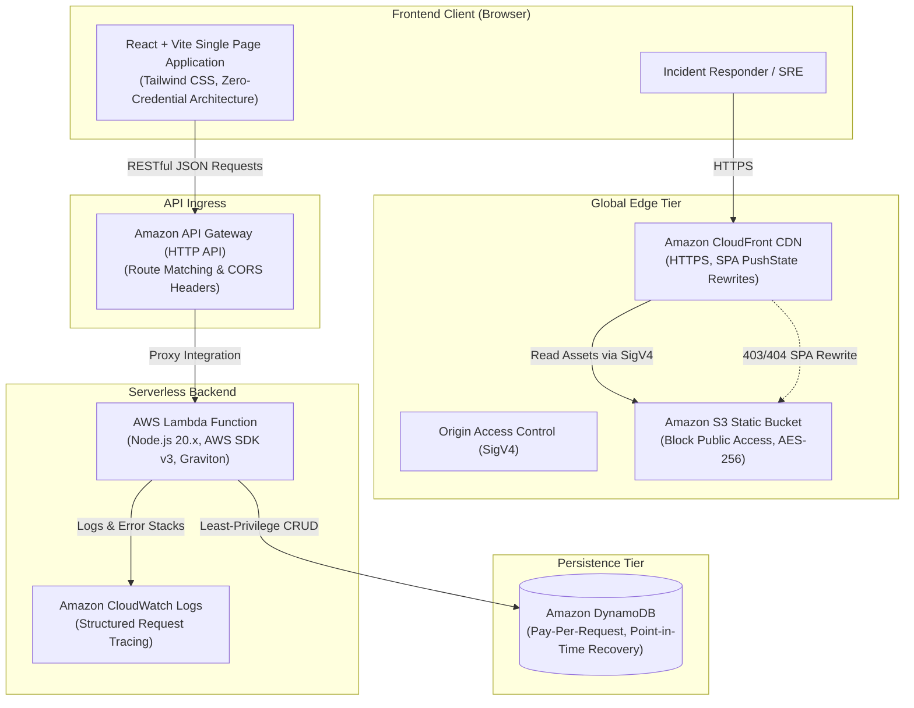

# RecoverOps — Serverless Incident Management System

[](https://aws.amazon.com/serverless/)
[](https://react.dev/)
[](https://aws.amazon.com/lambda/)
[](https://aws.amazon.com/dynamodb/)
[](#test-suite-verification)

RecoverOps is a production-ready, serverless incident management web application engineered for software engineering, platform, and SRE teams. It coordinates incident declaration, severity triage, root cause analysis, mitigation tracking, and post-incident resolution with zero ongoing server maintenance or idle costs.

---

## 1. Architecture Overview

RecoverOps follows AWS Well-Architected Serverless principles:



---

## 2. Core Features

1. **Operational Dashboard KPIs**: Real-time counters for Total Incidents, Active/Open Incidents, Critical (P0) Blockers, and Resolved Incidents with overall resolution rate.
2. **Interactive Filtering & Search**:
   - Substring search across Incident ID, Title, and Description.
   - Filter by Severity: `Critical (P0)`, `High (P1)`, `Medium (P2)`, `Low (P3)`.
   - Filter by Status: `Investigating`, `Identified`, `Monitoring`, `Resolved`.
   - Filter by Affected Service: `Payment Gateway`, `Auth & SSO`, `Billing API`, `Search Cluster`, etc.
   - One-click KPI filter linking (click the "Critical" stat card to view all P0 incidents).
3. **Complete Incident Lifecycle Management**:
   - **Declare Incident**: Title, Affected Service, Severity, Status, Assignee, Impact Description.
   - **Triage & Edit**: Rapidly adjust severity, assignees, or details.
   - **Resolve Incident**: Enforces mandatory Root Cause Analysis and Resolution/Remediation Notes before closing.
4. **Chronological Activity Timeline**:
   - Every incident maintains a chronological audit trail (creation, severity changes, status changes, and resolution).
   - In-app timeline composer allowing engineers to post real-time investigation updates and mitigation steps.
5. **State Feedback**: Skeleton loaders during network fetch, empty state illustrations with action callouts, and animated toast notifications for all operations.
6. **Zero-Credential Browser Security**: The browser code contains zero AWS credentials, tokens, or IAM secrets. All authorization and database mutations are securely encapsulated inside AWS Lambda.
7. **Transparent Connection Engine**:
   - Top navigation bar indicates real-time backend connection status (`AWS API Gateway Live` vs `Local Dev Mode`).
   - Built-in API configuration modal with live `/health` latency testing.

---

## 3. Project Structure

```
RecoverOps/
├── frontend/                     # React + Vite Frontend
│   ├── public/                   # Static assets & favicon
│   ├── src/
│   │   ├── components/           # Reusable UI Components
│   │   │   ├── Navbar.jsx
│   │   │   ├── DashboardStats.jsx
│   │   │   ├── FilterBar.jsx
│   │   │   ├── IncidentList.jsx
│   │   │   ├── IncidentModal.jsx
│   │   │   ├── IncidentDetailDrawer.jsx
│   │   │   ├── ResolveModal.jsx
│   │   │   ├── TimelineView.jsx
│   │   │   ├── StatusBadge.jsx
│   │   │   ├── SeverityBadge.jsx
│   │   │   ├── LoadingSkeleton.jsx
│   │   │   ├── EmptyState.jsx
│   │   │   ├── NotificationToast.jsx
│   │   │   └── ApiConfigModal.jsx
│   │   ├── services/
│   │   │   ├── api.js            # Unified API Client (AWS API Gateway + Local Fallback)
│   │   │   └── mockData.js       # Seed dataset for offline development
│   │   ├── utils/
│   │   │   ├── constants.js      # Statuses, severities, team, and services
│   │   │   └── formatDate.js     # Timestamp formatting utilities
│   │   ├── App.jsx               # Main Application Orchestrator
│   │   ├── index.css             # Tailwind CSS Directives
│   │   └── main.jsx
│   ├── index.html
│   ├── vite.config.js
│   ├── tailwind.config.js
│   ├── postcss.config.js
│   └── package.json
│
├── backend/                      # Serverless AWS Lambda Backend
│   ├── src/
│   │   ├── handler.js            # Lambda Router (API Gateway Proxy Event Processor)
│   │   ├── services/
│   │   │   └── dynamoService.js  # DynamoDB DocumentClient operations
│   │   ├── utils/
│   │   │   ├── response.js       # Standardized API response helper & CORS
│   │   │   └── validator.js      # Input validation & schema rules
│   │   └── local-dev-server.js   # Local HTTP runner simulating API Gateway
│   ├── tests/                    # Vitest Unit Test Suite
│   │   ├── validator.test.js
│   │   ├── response.test.js
│   │   ├── dynamoService.test.js
│   │   └── handler.test.js
│   ├── vitest.config.js
│   └── package.json
│
├── infrastructure/               # Infrastructure as Code
│   ├── template.yaml             # AWS SAM / CloudFormation Template
│   ├── deploy-backend.sh         # Linux/macOS Backend Deploy Script
│   ├── deploy-backend.ps1        # Windows PowerShell Backend Deploy Script
│   ├── deploy-frontend.sh        # Frontend Build & S3/CloudFront Sync Script
│   ├── deploy-frontend.ps1       # Windows PowerShell Frontend Deploy Script
│   ├── deploy-all.sh             # Full-Stack Automated Deploy Script
│   └── deploy-all.ps1            # Windows PowerShell Full-Stack Deploy Script
│
├── docs/                         # Detailed Technical Documentation
│   ├── ARCHITECTURE.md           # Architecture diagrams & DynamoDB data model
│   ├── API_DOCUMENTATION.md      # REST API endpoints, schemas, and curl examples
│   └── DEPLOYMENT_GUIDE.md       # SAM CLI & Manual AWS Console walkthroughs
│
├── package.json                  # Root runner scripts
└── README.md
```

---

## 4. Quick Start

### 4.1 Prerequisites
- Node.js (v20+ recommended)
- npm (v10+ recommended)

### 4.2 Local Development

1. **Clone the repository and install dependencies**:
   ```bash
   cd RecoverOps
   cd frontend && npm install
   cd ../backend && npm install
   cd ..
   ```

2. **Run Backend Lambda Dev Server (Optional, port 4000)**:
   ```bash
   npm run dev:api
   ```
   *Runs a local HTTP server executing the actual Lambda handler and in-memory DynamoDB store at `http://localhost:4000`.*

3. **Run Frontend Application (port 3000)**:
   ```bash
   npm run dev
   ```
   *Open [http://localhost:3000](http://localhost:3000) in your browser.*

---

## 5. Test Suite Verification

RecoverOps includes a comprehensive test suite covering validation rules, CORS headers, DynamoDB DocumentClient operations, and end-to-end Lambda router handlers.

Run all tests:
```bash
npm test
```

### Test Results
```
 ✓ tests/validator.test.js (10 tests)
 ✓ tests/response.test.js (4 tests)
 ✓ tests/dynamoService.test.js (8 tests)
 ✓ tests/handler.test.js (11 tests)

 Test Files  4 passed (4)
      Tests  33 passed (33)
   Duration  894ms
```

---

## 6. Production Build Verification

The frontend production bundle is compiled and tree-shaken with Vite:

```bash
npm run build
```

Output:
```
dist/index.html                   1.04 kB │ gzip:  0.58 kB
dist/assets/index-DQNfUQS4.css   31.72 kB │ gzip:  6.11 kB
dist/assets/index-DXxE-zCl.js   228.21 kB │ gzip: 65.47 kB
✓ built in 4.11s
```

---

## 7. Cloud Deployment to AWS

Detailed deployment steps and AWS Console guides are documented in [docs/DEPLOYMENT_GUIDE.md](docs/DEPLOYMENT_GUIDE.md).

### Automated One-Command Deploy (with AWS CLI configured):

**On Linux/macOS:**
```bash
./infrastructure/deploy-all.sh recoverops-stack us-east-1 prod
```

**On Windows (PowerShell):**
```powershell
./infrastructure/deploy-all.ps1 -StackName recoverops-stack -Region us-east-1 -Environment prod
```

### AWS Resources Provisioned:
- **Hosting**: Amazon S3 (private bucket) + Amazon CloudFront (OAC SigV4, HTTPS).
- **Ingress**: Amazon API Gateway HTTP API with CORS.
- **Compute**: AWS Lambda (Node.js 20.x, ARM64) with least-privilege IAM execution role.
- **Persistence**: Amazon DynamoDB (`PAY_PER_REQUEST` On-Demand, Point-in-time recovery, GSI).
- **Monitoring**: Amazon CloudWatch Logs (30-day retention) & Metrics.

---

## 8. API Reference

For complete request/response schemas, validation rules, and curl examples, see [docs/API_DOCUMENTATION.md](docs/API_DOCUMENTATION.md).

| Method | Endpoint | Description |
| :--- | :--- | :--- |
| `GET` | `/health` | Service and DynamoDB health check |
| `GET` | `/incidents` | List incidents with search & filters |
| `POST` | `/incidents` | Declare a new incident |
| `GET` | `/incidents/{id}` | Fetch full incident details & timeline |
| `PUT` | `/incidents/{id}` | Update incident or resolve with root cause |
| `POST` | `/incidents/{id}/timeline` | Append an activity timeline note |
| `DELETE` | `/incidents/{id}` | Delete an incident |

---

## 9. License

MIT License. Designed and engineered for software teams requiring dependable incident management.
